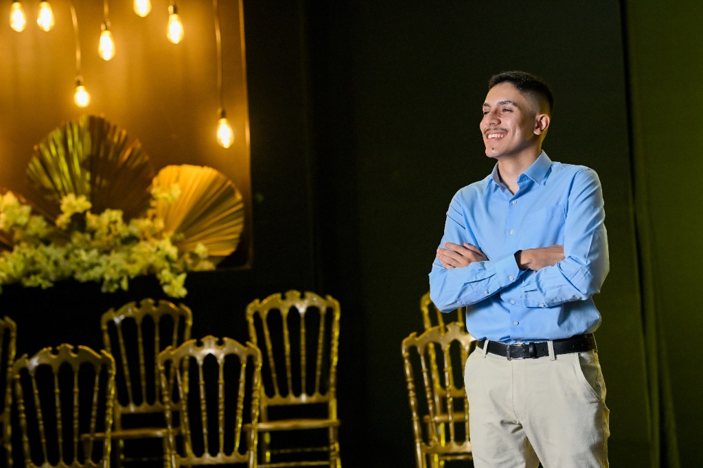

```{r}
#| include: false
if (!file.exists("dados/catalogo_boletins.rds")) {
  source("scripts/compilar_boletins.R", local = TRUE)
}
catalogo_boletins <- readRDS("dados/catalogo_boletins.rds")
url_substack <- "https://substack.com"
```

```{=html}
<style>
/* ==========================================================================
   BASE EDITORIAL & RESET QUARTO PARA O FEED ESTILO PORTAL DE NOTÍCIAS (G1)
   ========================================================================== */
:root {
  --jet-navy: #0f2537;
  --jet-navy-light: #1c3b57;
  --jet-gold: #c8942b;
  --jet-gold-soft: #fdf7eb;
  --jet-green: #0b5d32;
  --jet-cobalt: #0a2e73;
  --jet-bg: #f4f6f9;
  --jet-border: #e2e8f0;
  --jet-text: #1e293b;
  --jet-muted: #475569;
}

html, body {
  background-color: var(--jet-bg);
  color: var(--jet-text);
  font-family: "Inter", -apple-system, BlinkMacSystemFont, "Segoe UI", Roboto, Arial, sans-serif;
  margin: 0;
  padding: 0;
  max-width: 100%;
  overflow-x: hidden;
}

.quarto-title-banner, #title-block-header, #quarto-header {
  display: none !important;
}

#quarto-content {
  display: block !important;
  max-width: 1260px !important;
  width: 100% !important;
  margin: 0 auto !important;
  padding: 0 !important;
  box-sizing: border-box !important;
}

main.content,
main#quarto-document-content.content {
  max-width: 1260px !important;
  width: 100% !important;
  margin: 0 auto !important;
  padding: 18px 22px 48px 22px !important;
  box-sizing: border-box !important;
}

/* ==========================================================================
   BARRA GLOBAL DE NAVEGAÇÃO DO ECOSSISTEMA JET (3 ABAS + INÍCIO)
   ========================================================================== */
.jet-eco-topbar {
  position: sticky;
  top: 0;
  z-index: 1100;
  background: rgba(255, 255, 255, 0.96);
  backdrop-filter: blur(10px);
  border-bottom: 2px solid var(--jet-navy);
  box-shadow: 0 4px 16px rgba(15, 37, 55, 0.06);
  width: 100%;
}
.jet-eco-topbar-inner {
  max-width: 1240px;
  margin: 0 auto;
  padding: 8px 22px;
  display: flex;
  align-items: center;
  justify-content: space-between;
  gap: 14px;
  flex-wrap: wrap;
}
.jet-eco-brand {
  display: inline-flex;
  align-items: center;
  gap: 10px;
  text-decoration: none !important;
  color: var(--jet-navy) !important;
}
.jet-monogram-badge {
  display: inline-flex;
  align-items: center;
  justify-content: center;
  width: 34px;
  height: 34px;
  border-radius: 7px;
  background: linear-gradient(135deg, #0f2537 0%, #1c3b57 100%);
  color: #c8942b;
  border: 1.5px solid #c8942b;
  font-family: Georgia, "Times New Roman", serif;
  font-size: 0.78rem;
  font-weight: 900;
  letter-spacing: 0.5px;
  flex-shrink: 0;
  box-shadow: 0 2px 6px rgba(15, 37, 55, 0.16);
}
.jet-eco-brand-txt {
  display: flex;
  flex-direction: column;
  line-height: 1.15;
}
.jet-eco-brand-txt strong {
  font-family: "Georgia", serif;
  font-size: 0.98rem;
  font-weight: 900;
  color: var(--jet-navy);
  letter-spacing: -0.2px;
}
.jet-eco-brand-txt span {
  font-size: 0.68rem;
  color: var(--jet-muted);
  font-weight: 600;
  text-transform: uppercase;
  letter-spacing: 0.5px;
}
.jet-eco-nav {
  display: flex;
  align-items: center;
  gap: 10px;
  flex-wrap: wrap;
}
.jet-eco-tab {
  display: inline-flex;
  align-items: center;
  justify-content: center;
  gap: 8px;
  padding: 10px 20px;
  border-radius: 8px;
  font-size: 0.88rem;
  font-weight: 700;
  color: var(--jet-navy) !important;
  background: #ffffff;
  border: 1.5px solid #cbd5e1;
  text-decoration: none !important;
  letter-spacing: 0.1px;
  transition: all 0.25s cubic-bezier(0.16, 1, 0.3, 1);
}
.jet-eco-tab:hover {
  background: #f8fafc;
  border-color: var(--jet-navy);
  transform: translateY(-1px);
  box-shadow: 0 4px 12px rgba(15, 37, 55, 0.08);
}
.jet-eco-tab.active {
  background: var(--jet-navy);
  color: #ffffff !important;
  border-color: var(--jet-navy);
  border-bottom: 3px solid var(--jet-gold);
  box-shadow: 0 4px 14px rgba(15, 37, 55, 0.18);
}
.jet-panel-svg {
  width: 16px;
  height: 16px;
  flex-shrink: 0;
  display: inline-block;
}

/* ==========================================================================
   ANIMAÇÕES DE FLUIDEZ (ENTRADA E SCROLL REVEAL)
   ========================================================================== */
@keyframes jetFeedEnter {
  0% { opacity: 0; transform: translateY(14px); }
  100% { opacity: 1; transform: translateY(0); }
}
.jet-anim-in {
  animation: jetFeedEnter 0.45s cubic-bezier(0.16, 1, 0.3, 1) both;
}
.jet-reveal-item {
  opacity: 0;
  transform: translateY(16px);
  transition: opacity 0.52s cubic-bezier(0.16, 1, 0.3, 1), transform 0.52s cubic-bezier(0.16, 1, 0.3, 1);
}
.jet-reveal-item.is-visible {
  opacity: 1;
  transform: translateY(0);
}
@media (prefers-reduced-motion: reduce) {
  .jet-anim-in, .jet-reveal-item {
    animation: none !important;
    opacity: 1 !important;
    transform: none !important;
    transition: none !important;
  }
}

/* ==========================================================================
   CABEÇALHO EDITORIAL DO FEED (JORNALÍSTICO E LIMPO)
   ========================================================================== */
.jet-feed-masthead {
  background: #ffffff;
  border: 1px solid var(--jet-border);
  border-top: 5px solid var(--jet-navy);
  border-radius: 10px;
  padding: 20px 26px 18px 26px;
  margin-bottom: 20px;
  box-shadow: 0 2px 12px rgba(15, 37, 55, 0.04);
}
.jet-feed-masthead-top {
  display: flex;
  justify-content: space-between;
  align-items: center;
  flex-wrap: wrap;
  gap: 8px;
  border-bottom: 1px solid var(--jet-border);
  padding-bottom: 8px;
  margin-bottom: 12px;
  font-size: 0.72rem;
  font-weight: 700;
  text-transform: uppercase;
  letter-spacing: 0.6px;
  color: var(--jet-muted);
}
.jet-feed-title-row {
  display: flex;
  justify-content: space-between;
  align-items: flex-end;
  gap: 16px;
  flex-wrap: wrap;
}
.jet-feed-title-row h1 {
  font-family: "Georgia", "Times New Roman", serif;
  font-size: 2.05rem;
  font-weight: 900;
  color: var(--jet-navy);
  margin: 0 0 4px 0;
  line-height: 1.1;
}
.jet-feed-title-row p {
  margin: 0;
  font-size: 0.94rem;
  color: var(--jet-muted);
}

/* Barra de Filtros Editoriais e Autores */
.jet-toolbar-row {
  display: flex;
  justify-content: space-between;
  align-items: center;
  flex-wrap: wrap;
  gap: 12px;
  background: #ffffff;
  border: 1px solid var(--jet-border);
  border-left: 5px solid var(--jet-gold);
  padding: 12px 18px;
  border-radius: 8px;
  margin-bottom: 22px;
  box-shadow: 0 2px 8px rgba(15, 37, 55, 0.03);
}
.jet-filter-group {
  display: flex;
  gap: 6px;
  flex-wrap: wrap;
  align-items: center;
}
.jet-filter-btn {
  background: #f1f5f9;
  border: 1px solid #cbd5e1;
  color: #334155;
  font-size: 0.78rem;
  font-weight: 700;
  padding: 6px 13px;
  border-radius: 999px;
  cursor: pointer;
  transition: all 0.18s ease;
}
.jet-filter-btn:hover {
  background: #e2e8f0;
  color: var(--jet-navy);
}
.jet-filter-btn.active {
  background: var(--jet-navy);
  color: #ffffff;
  border-color: var(--jet-navy);
}
.jet-filter-btn.author-pill {
  background: #fdf7eb;
  border-color: #e6c88a;
  color: #7c5812;
}
.jet-filter-btn.author-pill.active {
  background: var(--jet-gold);
  color: var(--jet-navy);
  border-color: var(--jet-gold);
}

/* ==========================================================================
   LAYOUT G1 EM 2 COLUNAS: FEED VERTICAL À ESQUERDA + SIDEBAR À DIREITA
   ========================================================================== */
.jet-g1-layout {
  display: grid;
  grid-template-columns: minmax(0, 1fr) 340px;
  gap: 28px;
  align-items: start;
  margin-bottom: 38px;
  width: 100%;
  box-sizing: border-box;
}
.jet-g1-layout > * {
  min-width: 0;
}

.jet-g1-feed-column {
  min-width: 0;
  background: #ffffff;
  border: 1px solid var(--jet-border);
  border-radius: 12px;
  padding: 8px 26px 20px 26px;
  box-shadow: 0 2px 14px rgba(15, 37, 55, 0.04);
}

/* Destaque Hero da Carta de Conjuntura no topo do Feed */
.jet-carta-hero {
  background: linear-gradient(135deg, #0A2E73 0%, #071f4e 100%);
  color: #ffffff;
  border-radius: 10px;
  border-top: 4px solid #8CE000;
  padding: 18px 22px;
  margin: 14px 0 6px 0;
  box-shadow: 0 8px 22px rgba(10, 46, 115, 0.14);
}
.jet-carta-hero-grid {
  display: grid;
  grid-template-columns: 1fr auto;
  gap: 18px;
  align-items: center;
}
.jet-carta-sec-pills {
  display: flex;
  flex-wrap: wrap;
  gap: 5px;
  margin-top: 10px;
}
.jet-carta-sec-pill {
  background: rgba(255, 255, 255, 0.12);
  border: 1px solid rgba(140, 224, 0, 0.45);
  color: #f8fafc;
  font-size: 0.70rem;
  font-weight: 700;
  padding: 2px 8px;
  border-radius: 4px;
}

/* Item Vertical estilo G1 (Imagem à esquerda + Texto & Bullets à direita) */
.jet-g1-card {
  display: grid;
  grid-template-columns: 265px minmax(0, 1fr);
  gap: 22px;
  padding: 22px 0;
  border-bottom: 1px solid #e2e8f0;
  align-items: start;
}
.jet-g1-card:last-child {
  border-bottom: none;
}
.jet-g1-thumb-link {
  display: block;
  position: relative;
  border-radius: 10px;
  overflow: hidden;
  background: #f8fafc;
  border: 1px solid #cbd5e1;
  aspect-ratio: 16 / 10;
  box-shadow: 0 2px 8px rgba(15, 37, 55, 0.06);
}
.jet-g1-thumb-link img {
  width: 100%;
  height: 100%;
  object-fit: cover;
  object-position: center;
  transition: transform 0.35s cubic-bezier(0.16, 1, 0.3, 1);
  display: block;
}
.jet-g1-card:hover .jet-g1-thumb-link img {
  transform: scale(1.04);
}
.jet-g1-thumb-badge {
  position: absolute;
  top: 8px;
  left: 8px;
  font-size: 0.63rem;
  font-weight: 800;
  text-transform: uppercase;
  letter-spacing: 0.4px;
  padding: 3px 8px;
  border-radius: 4px;
  box-shadow: 0 2px 6px rgba(0, 0, 0, 0.22);
}
.jet-g1-kicker {
  font-size: 0.76rem;
  font-weight: 800;
  text-transform: uppercase;
  letter-spacing: 0.4px;
  margin-bottom: 5px;
  display: flex;
  align-items: center;
  gap: 8px;
  flex-wrap: wrap;
}
.jet-g1-headline {
  display: block;
  font-family: "Georgia", "Times New Roman", serif;
  font-size: 1.32rem;
  font-weight: 800;
  line-height: 1.24;
  color: var(--jet-navy) !important;
  text-decoration: none !important;
  margin-bottom: 8px;
  transition: color 0.15s ease;
}
.jet-g1-headline:hover {
  color: #9a6c11 !important;
}
.jet-g1-bullets {
  margin: 0 0 10px 0;
  padding-left: 16px;
  list-style: disc;
}
.jet-g1-bullets li {
  font-size: 0.84rem;
  font-weight: 600;
  line-height: 1.38;
  color: #334155;
  margin-bottom: 4px;
}
.jet-g1-bullets li::marker {
  color: var(--jet-gold);
}
.jet-g1-deck {
  font-size: 0.86rem;
  color: #475569;
  line-height: 1.45;
  margin: 0 0 10px 0;
}
.jet-g1-meta-row {
  display: flex;
  align-items: center;
  justify-content: space-between;
  flex-wrap: wrap;
  gap: 10px;
  padding-top: 8px;
}
.jet-g1-author-mini {
  display: inline-flex;
  align-items: center;
  gap: 8px;
}
.jet-g1-author-mini img {
  width: 30px;
  height: 30px;
  border-radius: 50%;
  object-fit: cover;
  border: 1.5px solid var(--jet-gold);
}
.jet-g1-author-mini-info {
  font-size: 0.75rem;
  line-height: 1.2;
  color: #334155;
}
.jet-g1-author-mini-info strong {
  color: var(--jet-navy);
}
.jet-g1-actions {
  display: inline-flex;
  align-items: center;
  gap: 8px;
}
.jet-g1-btn-read {
  font-size: 0.76rem;
  font-weight: 800;
  color: var(--jet-navy) !important;
  text-decoration: none !important;
  padding: 5px 10px;
  border-radius: 6px;
  background: #f1f5f9;
  transition: background 0.15s ease;
}
.jet-g1-btn-read:hover {
  background: #e2e8f0;
}
.jet-g1-btn-pdf {
  font-size: 0.74rem;
  font-weight: 800;
  padding: 5px 10px;
  border-radius: 6px;
  text-decoration: none !important;
  display: inline-flex;
  align-items: center;
  gap: 4px;
}

/* ==========================================================================
   COLUNA LATERAL DIREITA: ECONOMISTAS (FOTOS + BIOS) & "LEIA TAMBÉM"
   ========================================================================== */
.jet-g1-sidebar {
  position: sticky;
  top: 68px;
  display: flex;
  flex-direction: column;
  gap: 18px;
}
.jet-side-box {
  background: #ffffff;
  border: 1px solid var(--jet-border);
  border-radius: 12px;
  padding: 18px;
  box-shadow: 0 2px 12px rgba(15, 37, 55, 0.04);
}
.jet-side-box-title {
  font-family: "Georgia", serif;
  font-size: 1.05rem;
  font-weight: 900;
  color: var(--jet-navy);
  margin: 0 0 14px 0;
  padding-bottom: 8px;
  border-bottom: 2px solid var(--jet-gold);
  display: flex;
  align-items: center;
  justify-content: space-between;
}

/* Cartões Humanizados dos Economistas com Foto e Descrição */
.jet-author-profile-card {
  border: 1px solid #e2e8f0;
  border-radius: 10px;
  overflow: hidden;
  margin-bottom: 14px;
  background: #fafbfd;
  transition: transform 0.2s ease, box-shadow 0.2s ease;
}
.jet-author-profile-card:last-of-type {
  margin-bottom: 0;
}
.jet-author-profile-card:hover {
  transform: translateY(-2px);
  box-shadow: 0 6px 16px rgba(15, 37, 55, 0.08);
}
.jet-author-photo-wrap {
  width: 100%;
  height: 175px;
  overflow: hidden;
  position: relative;
  background: #0f2537;
}
.jet-author-photo-wrap img {
  width: 100%;
  height: 100%;
  object-fit: cover;
  display: block;
}
.jet-author-photo-caption {
  padding: 12px 14px;
}
.jet-author-name {
  font-family: "Georgia", serif;
  font-size: 1.02rem;
  font-weight: 900;
  color: var(--jet-navy);
  margin: 0 0 3px 0;
}
.jet-author-role {
  display: inline-block;
  font-size: 0.72rem;
  font-weight: 800;
  text-transform: uppercase;
  letter-spacing: 0.4px;
  color: var(--jet-navy);
  background: var(--jet-gold-soft);
  border: 1px solid #e5c687;
  padding: 2px 8px;
  border-radius: 4px;
  margin-bottom: 8px;
}
.jet-author-bio {
  font-size: 0.80rem;
  line-height: 1.45;
  color: #475569;
  margin: 0 0 8px 0;
}
.jet-author-filter-link {
  background: none;
  border: none;
  padding: 0;
  font-size: 0.76rem;
  font-weight: 800;
  color: var(--jet-navy);
  cursor: pointer;
  text-decoration: underline;
  text-decoration-color: var(--jet-gold);
}
.jet-author-filter-link:hover {
  color: #9a6c11;
}

/* Widget "Leia também ⬇️" Estilo G1 */
.jet-leia-item {
  display: grid;
  grid-template-columns: 1fr 78px;
  gap: 12px;
  align-items: center;
  padding: 11px 0;
  border-bottom: 1px solid #e2e8f0;
  text-decoration: none !important;
}
.jet-leia-item:last-child {
  border-bottom: none;
  padding-bottom: 2px;
}
.jet-leia-txt {
  font-size: 0.86rem;
  font-weight: 700;
  line-height: 1.32;
  color: var(--jet-navy);
  transition: color 0.15s ease;
}
.jet-leia-item:hover .jet-leia-txt {
  color: #9a6c11;
}
.jet-leia-sub {
  display: block;
  font-size: 0.70rem;
  font-weight: 600;
  color: #64748b;
  margin-top: 3px;
}
.jet-leia-thumb {
  width: 78px;
  height: 58px;
  border-radius: 8px;
  object-fit: cover;
  border: 1px solid #cbd5e1;
  background: #f8fafc;
}

.jet-substack-side input[type="email"] {
  width: 100%;
  padding: 8px 11px;
  border: 1px solid #94a3b8;
  border-radius: 6px;
  font-size: 0.82rem;
  margin-bottom: 8px;
  box-sizing: border-box;
}
.jet-substack-side button {
  width: 100%;
  background: var(--jet-gold);
  color: var(--jet-navy);
  font-weight: 800;
  font-size: 0.82rem;
  border: none;
  padding: 9px 12px;
  border-radius: 6px;
  cursor: pointer;
}

/* ==========================================================================
   CADERNOS DE LEITURA INTEGRAL (POSTS HTML EXEMPLARES COM FOTO DO AUTOR)
   ========================================================================== */
.jet-section-header {
  display: flex;
  justify-content: space-between;
  align-items: baseline;
  border-bottom: 2px solid var(--jet-navy);
  padding-bottom: 6px;
  margin: 34px 0 18px 0;
}
.jet-section-header h3 {
  font-family: "Georgia", "Times New Roman", serif;
  font-size: 1.28rem;
  font-weight: 800;
  color: var(--jet-navy);
  margin: 0;
  text-transform: uppercase;
  letter-spacing: 0.4px;
}
.card-boletim {
  background-color: #ffffff;
  border-radius: 10px;
  padding: 28px 34px;
  margin-bottom: 34px;
  box-shadow: 0 4px 20px rgba(15, 37, 55, 0.06);
  border: 1px solid #cbd5e1;
  border-top: 6px solid #0f2537;
  scroll-margin-top: 76px;
}
.card-boletim.layout-periodico {
  background-color: #fdfcf9;
  border-top: 6px solid #0B5D32;
}
@keyframes jetHighlightCard {
  0% { box-shadow: 0 0 0 4px rgba(200, 148, 43, 0.55); }
  100% { box-shadow: 0 4px 20px rgba(15, 37, 55, 0.06); }
}
.card-boletim.jet-post-focused {
  animation: jetHighlightCard 1.5s ease-out;
}
.meta-boletim {
  display: flex;
  justify-content: space-between;
  align-items: center;
  flex-wrap: wrap;
  gap: 10px;
  padding-bottom: 10px;
  margin-bottom: 14px;
  border-bottom: 2px solid #0f2537;
}
.card-boletim.layout-periodico .meta-boletim {
  border-bottom: 2px solid #0B5D32;
}
.badge-categoria {
  background-color: #0f2537;
  color: #c8942b;
  font-weight: 800;
  font-size: 0.74rem;
  padding: 4px 11px;
  border-radius: 3px;
  letter-spacing: 0.5px;
  text-transform: uppercase;
}
.manchete-jornal {
  font-family: "Georgia", "Times New Roman", serif;
  font-size: 1.75rem;
  font-weight: 900;
  color: #0f2537;
  line-height: 1.18;
  margin: 0 0 8px 0;
}
.card-boletim.layout-periodico .manchete-jornal {
  color: #0B5D32;
}
.subtitulo-boletim {
  font-family: "Georgia", "Times New Roman", serif;
  color: #475569;
  font-size: 1.05rem;
  font-style: italic;
  margin-bottom: 14px;
  line-height: 1.4;
}

/* Bloco Humanizado de Autoria Dentro do Post HTML */
.jet-post-author-box {
  display: flex;
  align-items: center;
  gap: 14px;
  background: #f8fafc;
  border: 1px solid #e2e8f0;
  border-left: 4px solid var(--jet-gold);
  border-radius: 8px;
  padding: 12px 16px;
  margin-bottom: 16px;
}
.jet-post-author-avatar {
  width: 62px;
  height: 62px;
  border-radius: 50%;
  object-fit: cover;
  flex-shrink: 0;
  border: 2px solid var(--jet-gold);
  box-shadow: 0 2px 8px rgba(15, 37, 55, 0.14);
}
.jet-post-author-details {
  flex: 1 1 auto;
  min-width: 0;
}
.jet-post-author-top {
  display: flex;
  align-items: center;
  flex-wrap: wrap;
  gap: 8px;
  margin-bottom: 3px;
}
.jet-post-author-top strong {
  font-size: 0.94rem;
  color: var(--jet-navy);
}
.jet-post-author-badge {
  font-size: 0.68rem;
  font-weight: 800;
  text-transform: uppercase;
  padding: 2px 8px;
  border-radius: 999px;
  background: var(--jet-navy);
  color: var(--jet-gold);
}
.jet-post-author-bio-inline {
  font-size: 0.78rem;
  color: #475569;
  line-height: 1.4;
  margin: 0 0 4px 0;
}
.jet-post-author-meta {
  font-size: 0.74rem;
  color: #64748b;
}

.destaque-executivo {
  background-color: #f8f9fa;
  border-left: 4px solid #c8942b;
  padding: 13px 18px;
  border-radius: 4px;
  margin: 14px 0 20px 0;
  font-size: 0.94rem;
  line-height: 1.5;
}
.secao-tag {
  background-color: #0f2537;
  color: #ffffff;
  padding: 7px 16px;
  border-radius: 3px;
  font-size: 0.82rem;
  font-weight: 800;
  text-transform: uppercase;
  letter-spacing: 0.5px;
  margin: 22px 0 14px 0;
  display: block;
  border-left: 5px solid #c8942b;
}
.jet-periodico-2col {
  column-count: 2;
  column-gap: 32px;
  column-rule: 1px solid #cbd5e1;
  text-align: justify;
  font-family: "Georgia", "Times New Roman", serif;
  font-size: 0.96rem;
  line-height: 1.62;
  color: #1e293b;
  margin: 12px 0 18px 0;
}
.jet-periodico-2col p:first-of-type::first-letter {
  float: left;
  font-family: "Georgia", "Times New Roman", serif;
  font-size: 2.7rem;
  line-height: 0.85;
  padding-right: 8px;
  padding-top: 3px;
  font-weight: 900;
  color: #0B5D32;
}
.jet-flash-2col {
  column-count: 2;
  column-gap: 28px;
  column-rule: 1px solid #e2e8f0;
  text-align: justify;
  font-size: 0.94rem;
  line-height: 1.58;
  color: #1e293b;
  margin: 10px 0 16px 0;
}
.painel-empirico-html {
  background-color: #ffffff;
  border: 1px solid #cbd5e1;
  border-radius: 6px;
  padding: 16px 18px;
  margin: 16px 0 20px 0;
}
.painel-empirico-html img,
.card-boletim img {
  max-width: 100%;
  height: auto;
}
.tabela-boletim-html {
  width: 100%;
  border-collapse: collapse;
  font-size: 0.85rem;
  margin-top: 6px;
}
.tabela-boletim-html th {
  padding: 8px 10px;
  text-align: left;
  font-weight: 700;
  border-bottom: 2px solid #c8942b;
}
.tabela-boletim-html td {
  padding: 6px 10px;
  border-bottom: 1px solid #e2e8f0;
}
.tabela-boletim-html tbody tr:nth-child(even) {
  background-color: #f8fafc;
}
.btn-pdf-latex {
  display: inline-flex;
  align-items: center;
  gap: 8px;
  background-color: #0f2537;
  color: #ffffff !important;
  text-decoration: none !important;
  font-weight: 800;
  font-size: 0.82rem;
  padding: 8px 15px;
  border-radius: 4px;
  border: 1px solid rgba(255,255,255,0.2);
  transition: all 0.18s ease;
}
.btn-pdf-latex:hover {
  opacity: 0.92;
  transform: translateY(-1px);
}

/* ==========================================================================
   RESPONSIVIDADE MOBILE & TABLET (<= 991.98px, <= 768px, <= 480px)
   ========================================================================== */
@media (max-width: 991.98px) {
  .jet-g1-layout {
    grid-template-columns: 1fr;
    gap: 20px;
  }
  .jet-g1-sidebar {
    position: static;
  }
  main.content {
    padding: 12px 12px 36px 12px !important;
  }
  .jet-periodico-2col, .jet-flash-2col {
    column-count: 1;
    text-align: left;
  }
  .jet-kpi-grid {
    grid-template-columns: repeat(2, minmax(0, 1fr)) !important;
  }
}

@media (max-width: 768px) {
  .jet-eco-topbar-inner {
    padding: 8px 12px;
    gap: 8px;
  }
  .jet-eco-nav {
    width: 100%;
    display: grid !important;
    grid-template-columns: repeat(2, minmax(0, 1fr)) !important;
    gap: 6px !important;
  }
  .jet-eco-tab {
    width: 100%;
    justify-content: center;
    padding: 9px 10px;
    font-size: 0.78rem;
  }
  .jet-feed-masthead {
    padding: 14px 14px;
  }
  .jet-feed-title-row h1 {
    font-size: 1.45rem;
  }
  .jet-toolbar-row {
    padding: 10px 12px;
  }
  .jet-filter-group {
    width: 100%;
  }
  .jet-filter-btn {
    flex: 1 1 calc(50% - 4px);
    text-align: center;
    font-size: 0.72rem;
    padding: 7px 8px;
  }
  .jet-g1-feed-column {
    padding: 6px 14px 14px 14px;
  }
  .jet-g1-card {
    grid-template-columns: 1fr;
    gap: 12px;
    padding: 16px 0;
  }
  .jet-g1-thumb-link {
    aspect-ratio: 16 / 9;
  }
  .jet-g1-headline {
    font-size: 1.15rem;
  }
  .jet-carta-hero-grid {
    grid-template-columns: 1fr;
  }
  .jet-carta-hero-grid > div:last-child {
    min-width: 0 !important;
    width: 100% !important;
  }
  .card-boletim {
    padding: 16px 14px;
    margin-bottom: 22px;
  }
  .jet-post-author-box {
    flex-direction: column;
    align-items: flex-start;
    padding: 12px 12px;
    gap: 10px;
  }
  .manchete-jornal {
    font-size: 1.28rem;
  }
  .subtitulo-boletim {
    font-size: 0.92rem;
  }
  .tabela-boletim-html {
    min-width: 480px;
    font-size: 0.78rem;
  }
  .tabela-boletim-html th,
  .tabela-boletim-html td {
    padding: 6px 8px !important;
    white-space: nowrap;
  }
  .card-boletim .btn-pdf-latex {
    width: 100%;
    justify-content: center;
  }
}

@media (max-width: 420px) {
  .jet-kpi-grid {
    grid-template-columns: 1fr !important;
  }
}
</style>

<!-- BARRA GLOBAL DO ECOSSISTEMA JET -->
<header class="jet-eco-topbar">
  <div class="jet-eco-topbar-inner">
    <a href="index.html" class="jet-eco-brand">
      <span class="jet-monogram-badge" aria-hidden="true">JET</span>
      <div class="jet-eco-brand-txt">
        <strong>Jornal Econômico do Tocantins</strong>
        <span>Observatório &amp; Jornalismo de Dados</span>
      </div>
    </a>
    <nav class="jet-eco-nav" aria-label="Navegação Principal JET">
      <a href="index.html" class="jet-eco-tab">Início</a>
      <a href="news.html" class="jet-eco-tab active">Feed e Boletins</a>
      <a href="index.html#banco-de-dados" class="jet-eco-tab">Banco de Dados</a>
      <a href="index.html#painel" class="jet-eco-tab">
        <svg class="jet-panel-svg" viewBox="0 0 24 24" fill="none" stroke="currentColor" stroke-width="2" stroke-linecap="round" stroke-linejoin="round" aria-hidden="true">
          <rect x="3" y="3" width="18" height="18" rx="3"></rect>
          <line x1="8" y1="16" x2="8" y2="11"></line>
          <line x1="12" y1="16" x2="12" y2="7"></line>
          <line x1="16" y1="16" x2="16" y2="13"></line>
        </svg>
        <span>Painel JET</span>
      </a>
    </nav>
  </div>
</header>

<!-- CABEÇALHO JORNALÍSTICO DO FEED -->
<section class="jet-feed-masthead jet-anim-in">
  <div class="jet-feed-masthead-top">
    <span>PALMAS — TOCANTINS &nbsp;•&nbsp; FEED DE ANÁLISES &amp; CADERNO EDITORIAL</span>
    <span>JORNALISMO ECONÔMICO BASEADO EM EVIDÊNCIAS</span>
  </div>
  <div class="jet-feed-title-row">
    <div>
      <h1>Feed Econômico &amp; Boletins do Tocantins</h1>
      <p>Leituras conjunturais assinadas por economistas, boletins executivos e dossiês setoriais com dados oficiais.</p>
    </div>
  </div>
</section>

<!-- BARRA DE FILTROS EDITORIAIS + FILTRO POR ECONOMISTA -->
<div class="jet-toolbar-row jet-anim-in">
  <div class="jet-filter-group">
    <button type="button" class="jet-filter-btn active" data-filter-group="fam" onclick="aplicarFiltroFeed('fam', 'todos', this)">Todas as Matérias (12)</button>
    <button type="button" class="jet-filter-btn" data-filter-group="fam" onclick="aplicarFiltroFeed('fam', 'flash', this)">⚡ Boletins Flash (6)</button>
    <button type="button" class="jet-filter-btn" data-filter-group="fam" onclick="aplicarFiltroFeed('fam', 'dossie', this)">📕 Dossiês Anuais (5)</button>
    <button type="button" class="jet-filter-btn" data-filter-group="fam" onclick="aplicarFiltroFeed('fam', 'carta', this)">📘 Carta de Conjuntura (1)</button>
  </div>
  <div class="jet-filter-group">
    <button type="button" class="jet-filter-btn author-pill active" data-filter-group="autor" onclick="aplicarFiltroFeed('autor', 'todos', this)">👥 Todos os Autores</button>
    <button type="button" class="jet-filter-btn author-pill" data-filter-group="autor" onclick="aplicarFiltroFeed('autor', 'tarcisio', this)">👤 Tarcisio Iago</button>
    <button type="button" class="jet-filter-btn author-pill" data-filter-group="autor" onclick="aplicarFiltroFeed('autor', 'lorenzo', this)">👤 Lorenzo Costa</button>
  </div>
</div>
```

```{r}
#| results: asis

# ==============================================================================
# 1. LAYOUT ESTILO G1: FEED VERTICAL À ESQUERDA + AUTORES & "LEIA TAMBÉM" À DIREITA
# ==============================================================================
cat("```{=html}\n")
cat('<div class="jet-g1-layout">\n')

# --- COLUNA ESQUERDA: STREAM VERTICAL DE MATÉRIAS ESTILO G1 ---
cat('  <div class="jet-g1-feed-column">\n')

if (file.exists("boletins/pdfs/2026_10_carta_pib.pdf")) {
  cat(
    '<div id="caderno-carta-conjuntura" class="jet-carta-hero jet-reveal-item" data-portal-fam="carta" data-portal-autor="todos">',
    '  <div class="jet-carta-hero-grid">',
    '    <div>',
    '      <div style="display:flex; align-items:center; gap:8px; flex-wrap:wrap; margin-bottom:6px;">',
    '        <span style="background:#8CE000; color:#0A2E73; font-weight:900; font-size:0.68rem; padding:3px 9px; border-radius:4px; text-transform:uppercase; letter-spacing:0.5px;">📘 Edição Especial • Carta de Conjuntura</span>',
    '      </div>',
    '      <h2 style="font-family:Georgia,serif; font-size:1.42rem; font-weight:900; color:#ffffff; margin:0 0 6px 0;">Carta de Conjuntura Econômica do Tocantins</h2>',
    '      <p style="margin:0; font-size:0.86rem; color:#e2e8f0; line-height:1.48;">Relatório analítico completo elaborado por Lorenzo Costa e Tarcisio Iago reunindo PIB, emprego formal, comércio exterior, finanças públicas, agropecuária e economia municipal.</p>',
    '      <div class="jet-carta-sec-pills">',
    '        <span class="jet-carta-sec-pill">1. Visão Intersetorial</span>',
    '        <span class="jet-carta-sec-pill">2. PIB &amp; Atividade</span>',
    '        <span class="jet-carta-sec-pill">3. Emprego</span>',
    '        <span class="jet-carta-sec-pill">4. Comex</span>',
    '        <span class="jet-carta-sec-pill">5. Finanças</span>',
    '        <span class="jet-carta-sec-pill">6. Empresas</span>',
    '        <span class="jet-carta-sec-pill">7. Agro &amp; Safras</span>',
    '        <span class="jet-carta-sec-pill">8. Municípios</span>',
    '      </div>',
    '    </div>',
    '    <div style="display:flex; flex-direction:column; gap:8px; min-width:210px;">',
    '      <a href="boletins/pdfs/2026_10_carta_pib.pdf" target="_blank" class="btn-pdf-latex" style="background:#8CE000; color:#0A2E73 !important; justify-content:center; font-size:0.84rem; padding:11px 16px;" download>📥 Baixar Carta (17 págs)</a>',
    '      <a href="boletins/pdfs/2026_10_carta_pib.pdf" target="_blank" style="text-align:center; font-size:0.74rem; color:#f8fafc !important; text-decoration:underline;">Abrir PDF no navegador →</a>',
    '    </div>',
    '  </div>',
    '</div>\n',
    sep = "\n"
  )
}

if (length(catalogo_boletins) > 0) {
  for (b in catalogo_boletins) {
    eh_per <- identical(b$estilo_layout, "periodico")
    fam_str <- if (eh_per) "dossie" else "flash"
    cor_p <- if (!is.null(b$cor_primaria)) b$cor_primaria else "#0f2537"
    cor_a <- if (!is.null(b$cor_acento)) b$cor_acento else "#c8942b"
    cor_badge_txt <- if (eh_per) "#FAF6EE" else "#C8942B"
    tag_layout <- if (eh_per) "Dossiê Anual" else "Boletim Flash"
    thumb_src <- if (!is.null(b$thumb_png) && nzchar(b$thumb_png) && file.exists(b$thumb_png)) b$thumb_png else "logo.png"
    resumo_curto <- if (nzchar(b$destaque_curto)) b$destaque_curto else b$subtitulo
    tema_curto <- if (!is.null(b$tema_nome) && nzchar(b$tema_nome)) b$tema_nome else b$categoria

    autor_id <- if (!is.null(b$autor_id)) b$autor_id else "lorenzo"
    autor_nome <- if (!is.null(b$autor_nome)) b$autor_nome else "Lorenzo Costa"
    autor_titulo <- if (!is.null(b$autor_titulo)) b$autor_titulo else "Graduado em Economia"
    autor_foto <- if (!is.null(b$autor_foto)) b$autor_foto else "assets/autores/lorenzo_costa.jpg"
    autor_pos <- if (!is.null(b$autor_foto_pos)) b$autor_foto_pos else "28% 18%"

    bullets_html <- ""
    if (!is.null(b$bullets_feed) && length(b$bullets_feed) > 0) {
      lis <- paste(sprintf('<li>%s</li>', b$bullets_feed), collapse = "")
      bullets_html <- sprintf('<ul class="jet-g1-bullets">%s</ul>', lis)
    }

    btn_pdf_card <- if (isTRUE(b$tem_pdf)) {
      sprintf('<a href="%s" target="_blank" class="jet-g1-btn-pdf" style="background:%s; color:%s !important;" download>📄 PDF</a>',
              b$pdf_url, cor_p, ifelse(eh_per, "#ffffff", "#C8942B"))
    } else ""

    cat(sprintf(
      '<article class="jet-g1-card jet-reveal-item" data-portal-fam="%s" data-portal-autor="%s">
  <a href="#%s" class="jet-g1-thumb-link" onclick="focarPostArtigo(\'%s\')">
    
    <span class="jet-g1-thumb-badge" style="background:%s; color:%s; border-left:3px solid %s;">%s</span>
  </a>
  <div>
    <div class="jet-g1-kicker" style="color:%s;">
      <span>%s</span>
      <span style="color:#94a3b8;">•</span>
      <span style="color:#64748b; font-weight:600;">%s</span>
    </div>
    <a href="#%s" class="jet-g1-headline" onclick="focarPostArtigo(\'%s\')">%s</a>
    %s
    <p class="jet-g1-deck">%s</p>
    <div class="jet-g1-meta-row">
      <div class="jet-g1-author-mini">
        
        <div class="jet-g1-author-mini-info">
          <strong>%s</strong> <span style="color:#64748b;">(%s)</span><br/>
          <span style="font-size:0.68rem; color:#64748b;">Publicado em %s</span>
        </div>
      </div>
      <div class="jet-g1-actions">
        <a href="#%s" class="jet-g1-btn-read" onclick="focarPostArtigo(\'%s\')">📖 Ler matéria ↓</a>
        %s
      </div>
    </div>
  </div>
</article>\n',
      fam_str, autor_id,
      b$slug, b$slug,
      thumb_src, gsub('"', '', b$titulo),
      cor_p, cor_badge_txt, cor_a, tag_layout,
      cor_p, tema_curto, b$periodo,
      b$slug, b$slug, b$titulo,
      bullets_html,
      resumo_curto,
      autor_foto, autor_nome, autor_pos,
      autor_nome, autor_titulo, b$data,
      b$slug, b$slug, btn_pdf_card
    ))
  }
}

cat('  </div>\n') # fim .jet-g1-feed-column

# --- COLUNA DIREITA: ECONOMISTAS (FOTOS + BIOS) & "LEIA TAMBÉM ⬇️" ---
cat('  <aside class="jet-g1-sidebar">\n')

# Card 1: Autores e Economistas
cat('    <div class="jet-side-box jet-anim-in">\n')
cat('      <h4 class="jet-side-box-title"><span>👥 Economistas do JET</span></h4>\n')

cat('      <div class="jet-author-profile-card">\n')
cat('        <div class="jet-author-photo-wrap">\n')
cat('          \n')
cat('        </div>\n')
cat('        <div class="jet-author-photo-caption">\n')
cat('          <h5 class="jet-author-name">Tarcisio Iago</h5>\n')
cat('          <span class="jet-author-role">Economista</span>\n')
cat('          <p class="jet-author-bio">Economista no Jornal Econômico do Tocantins (JET). Responsável pelas análises de mercado de trabalho formal, comércio exterior e dinâmica empresarial regional.</p>\n')
cat('          <button type="button" class="jet-author-filter-link" onclick="filtrarPorAutorSidebar(\'tarcisio\')">Ver publicações assinadas →</button>\n')
cat('        </div>\n')
cat('      </div>\n')

cat('      <div class="jet-author-profile-card">\n')
cat('        <div class="jet-author-photo-wrap">\n')
cat('          \n')
cat('        </div>\n')
cat('        <div class="jet-author-photo-caption">\n')
cat('          <h5 class="jet-author-name">Lorenzo Costa</h5>\n')
cat('          <span class="jet-author-role">Graduado em Economia</span>\n')
cat('          <p class="jet-author-bio">Graduado em Economia e editor do Jornal Econômico do Tocantins (JET). Atua em macroeconomia regional, séries dessazonalizadas, contas regionais e finanças públicas.</p>\n')
cat('          <button type="button" class="jet-author-filter-link" onclick="filtrarPorAutorSidebar(\'lorenzo\')">Ver publicações assinadas →</button>\n')
cat('        </div>\n')
cat('      </div>\n')
cat('    </div>\n')

# Card 2: Leia também (Estilo G1)
cat('    <div class="jet-side-box jet-anim-in">\n')
cat('      <h4 class="jet-side-box-title"><span>Leia também ⬇️</span></h4>\n')
if (length(catalogo_boletins) > 0) {
  n_rec <- min(4L, length(catalogo_boletins))
  for (j in seq_len(n_rec)) {
    rec <- catalogo_boletins[[j]]
    rec_thumb <- if (!is.null(rec$thumb_png) && nzchar(rec$thumb_png) && file.exists(rec$thumb_png)) rec$thumb_png else "logo.png"
    cat(sprintf(
      '<a href="#%s" class="jet-leia-item" onclick="focarPostArtigo(\'%s\')">
  <div class="jet-leia-txt">%s<span class="jet-leia-sub">%s • %s</span></div>
  
</a>\n',
      rec$slug, rec$slug, rec$titulo, rec$autor_nome, rec$periodo, rec_thumb, gsub('"', '', rec$titulo)
    ))
  }
}
cat('    </div>\n')

# Card 3: Receber Edições por E-mail
cat('    <div class="jet-side-box jet-substack-side">\n')
cat('      <h4 class="jet-side-box-title"><span>📩 Receba as Edições</span></h4>\n')
cat('      <p style="font-size:0.80rem; color:#475569; line-height:1.42; margin:0 0 10px 0;">Assine gratuitamente via Substack para receber novos boletins flash e a Carta de Conjuntura no seu e-mail.</p>\n')
cat('      <form onsubmit="event.preventDefault(); window.open(\'https://substack.com\', \'_blank\'); this.querySelector(\'button\').textContent = \'✓ Redirecionado!\';">\n')
cat('        <input type="email" placeholder="Seu e-mail profissional..." required />\n')
cat('        <button type="submit">Assinar via Substack</button>\n')
cat('      </form>\n')
cat('    </div>\n')

cat('  </aside>\n') # fim .jet-g1-sidebar
cat('</div>\n') # fim .jet-g1-layout

# ==============================================================================
# 2. ARTIGOS COMPLETOS NA ÍNTEGRA (COM ASSINATURA HUMANA & FOTO DO ECONOMISTA)
# ==============================================================================
cat('<div class="jet-section-header"><h3>📰 Leituras Completas &amp; Séries Históricas</h3><span style="font-size:0.78rem; color:#475569;">Artigos completos assinados pelos economistas do JET</span></div>\n')
cat("```\n")

if (length(catalogo_boletins) == 0) {
  cat("<p>Nenhum boletim publicado no momento.</p>")
} else {
  for (b in catalogo_boletins) {
    cor_p <- if (!is.null(b$cor_primaria)) b$cor_primaria else "#0f2537"
    cor_f <- if (!is.null(b$cor_fundo)) b$cor_fundo else "#f8f9fa"
    cor_a <- if (!is.null(b$cor_acento)) b$cor_acento else "#c8942b"
    eh_per <- identical(b$estilo_layout, "periodico")
    fam_str <- if (eh_per) "dossie" else "flash"
    cor_badge_txt <- if (eh_per) "#FAF6EE" else "#c8942b"
    classe_card <- if (eh_per) "card-boletim layout-periodico" else "card-boletim"
    classe_colunas <- if (eh_per) "jet-periodico-2col" else "jet-flash-2col"
    selo_layout <- if (eh_per) "📕 DOSSIÊ ANUAL" else "⚡ BOLETIM FLASH"

    autor_id <- if (!is.null(b$autor_id)) b$autor_id else "lorenzo"
    autor_nome <- if (!is.null(b$autor_nome)) b$autor_nome else "Lorenzo Costa"
    autor_titulo <- if (!is.null(b$autor_titulo)) b$autor_titulo else "Graduado em Economia"
    autor_foto <- if (!is.null(b$autor_foto)) b$autor_foto else "assets/autores/lorenzo_costa.jpg"
    autor_pos <- if (!is.null(b$autor_foto_pos)) b$autor_foto_pos else "28% 18%"
    autor_bio <- if (!is.null(b$autor_bio)) b$autor_bio else "Graduado em Economia e editor do Jornal Econômico do Tocantins (JET)."

    cat("```{=html}\n")
    cat(sprintf('<span id="%s" style="scroll-margin-top: 76px;"></span>\n', b$slug))
    cat(sprintf('<div id="post-%s" class="%s jet-reveal-item" data-portal-fam="%s" data-portal-autor="%s" style="border-top: 6px solid %s;">\n', b$slug, classe_card, fam_str, autor_id, cor_p))
    cat('<div class="meta-boletim">\n')
    cat(sprintf('  <div><span class="badge-categoria" style="background-color: %s; color: %s; border-left: 3px solid %s;">%s • %s</span> <span style="font-size: 0.75rem; color: %s; font-weight: 800; margin-left: 8px; letter-spacing: 0.4px;">%s</span></div>\n', cor_p, cor_badge_txt, cor_a, b$categoria, b$periodo, cor_p, selo_layout))
    if (isTRUE(b$tem_pdf)) {
      cat(sprintf('  <a href="%s" target="_blank" class="btn-pdf-latex" style="background-color: %s; color: #ffffff !important;" download>📥 Baixar em PDF</a>\n', b$pdf_url, cor_p))
    }
    cat('</div>\n')

    cat(sprintf('<h2 class="manchete-jornal">%s</h2>\n', b$titulo))
    cat(sprintf('<div class="subtitulo-boletim">%s</div>\n', b$subtitulo))

    # Bloco Humanizado de Autoria com Foto e Breve Descrição
    cat(sprintf(
      '<div class="jet-post-author-box">
  
  <div class="jet-post-author-details">
    <div class="jet-post-author-top">
      <strong>Por %s</strong>
      <span class="jet-post-author-badge">%s</span>
    </div>
    <p class="jet-post-author-bio-inline">%s</p>
    <div class="jet-post-author-meta"><strong>Data de Fechamento:</strong> %s &nbsp;•&nbsp; <strong>Fontes Primárias:</strong> %s</div>
  </div>
</div>\n',
      autor_foto, autor_nome, autor_pos,
      autor_nome, autor_titulo,
      autor_bio,
      b$data, b$fonte_curta
    ))

    if (nzchar(b$destaque_curto)) {
      cat(sprintf('<div class="destaque-executivo" style="background-color: %s; border-left: 4px solid %s;"><strong style="color: %s;">Síntese Executiva:</strong> %s</div>\n', cor_f, cor_a, cor_p, b$destaque_curto))
    }

    if (!is.null(b$kpis_html) && nzchar(b$kpis_html)) {
      cat(b$kpis_html, "\n")
    }

    if (!is.null(b$diagnostico_script_html) && nzchar(b$diagnostico_script_html)) {
      cat(b$diagnostico_script_html, "\n")
    }

    cat(sprintf('<div class="secao-tag" style="background-color: %s; border-left: 5px solid %s;">1. Panorama Estatístico e Evidência Empírica</div>\n', cor_p, cor_a))
    cat(sprintf('<div class="%s">%s</div>\n', classe_colunas, b$texto_auto_html))

    if (!is.null(b$visual_html) && nzchar(b$visual_html)) {
      cat(b$visual_html, "\n")
    }

    cat(sprintf('<div class="secao-tag" style="background-color: %s; border-left: 5px solid %s;">2. Análise de Conjuntura e Leitura Setorial</div>\n', cor_p, cor_a))
    cat(sprintf('<div class="%s">%s</div>\n', classe_colunas, b$conjuntura_html))

    if (nzchar(b$perspectivas_html)) {
      cat(sprintf('<div class="secao-tag" style="background-color: %s; border-left: 5px solid %s;">3. Perspectivas e Cenários</div>\n', cor_p, cor_a))
      cat(sprintf('<div class="%s">%s</div>\n', classe_colunas, b$perspectivas_html))
    }

    if (isTRUE(b$tem_pdf)) {
      cat(sprintf('<div style="margin-top: 18px; padding-top: 14px; border-top: 2px solid #cbd5e1; display: flex; justify-content: space-between; align-items: center; flex-wrap: wrap; gap: 10px;"><span style="font-size: 0.84rem; color: #475569;"><strong>Versão para Leitura Offline e Impressão:</strong> Baixe esta edição completa em PDF para arquivamento ou compartilhamento:</span><a href="%s" target="_blank" class="btn-pdf-latex" style="background-color: %s; color: #ffffff !important;" download>📥 Baixar Edição em PDF</a></div>\n', b$pdf_url, cor_p))
    }
    cat('</div>\n')
    cat("```\n\n")
  }
}
```

```{=html}
<script>
(function() {
  var filtroAtual = { fam: "todos", autor: "todos" };

  window.aplicarFiltroFeed = function(tipo, valor, btnEl) {
    filtroAtual[tipo] = valor;

    document.querySelectorAll('.jet-filter-btn[data-filter-group="' + tipo + '"]').forEach(function(b) {
      b.classList.remove("active");
    });
    if (btnEl) {
      btnEl.classList.add("active");
    } else {
      var selector = '.jet-filter-btn[data-filter-group="' + tipo + '"][onclick*="\\\'' + valor + '\\\'"]';
      var alvo = document.querySelector(selector);
      if (alvo) alvo.classList.add("active");
    }

    document.querySelectorAll("[data-portal-fam]").forEach(function(el) {
      var f = el.getAttribute("data-portal-fam");
      var a = el.getAttribute("data-portal-autor") || "todos";
      var passaFam = (filtroAtual.fam === "todos" || f === filtroAtual.fam);
      var passaAutor = (filtroAtual.autor === "todos" || a === "todos" || a === filtroAtual.autor);
      if (passaFam && passaAutor) {
        el.style.display = "";
        el.classList.add("is-visible");
      } else {
        el.style.display = "none";
      }
    });
  };

  window.filtrarPorAutorSidebar = function(autorId) {
    aplicarFiltroFeed("autor", autorId, null);
    window.scrollTo({ top: 140, behavior: "smooth" });
  };

  window.focarPostArtigo = function(slug) {
    // Garante que o filtro não esconda o artigo clicado via "Leia também"
    if (filtroAtual.fam !== "todos" || filtroAtual.autor !== "todos") {
      aplicarFiltroFeed("fam", "todos", null);
      aplicarFiltroFeed("autor", "todos", null);
    }
    setTimeout(function() {
      var card = document.getElementById("post-" + slug);
      if (card) {
        card.scrollIntoView({ behavior: "smooth", block: "start" });
        card.classList.remove("jet-post-focused");
        void card.offsetWidth;
        card.classList.add("jet-post-focused");
      }
    }, 50);
  };

  // Scroll Reveal elegante para os cards do Feed e Artigos
  if ("IntersectionObserver" in window) {
    var obs = new IntersectionObserver(function(entries) {
      entries.forEach(function(entry) {
        if (entry.isIntersecting) {
          entry.target.classList.add("is-visible");
          obs.unobserve(entry.target);
        }
      });
    }, { threshold: 0.06, rootMargin: "0px 0px -24px 0px" });

    document.querySelectorAll(".jet-reveal-item").forEach(function(el, idx) {
      if (idx < 3) {
        el.classList.add("is-visible");
      } else {
        obs.observe(el);
      }
    });
  } else {
    document.querySelectorAll(".jet-reveal-item").forEach(function(el) {
      el.classList.add("is-visible");
    });
  }
})();
</script>
```
